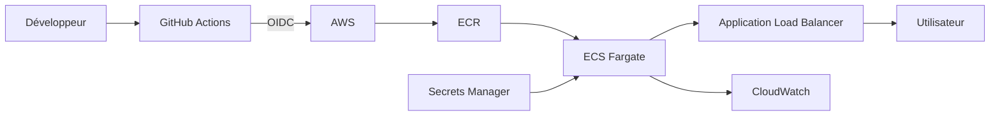

# TP DevSecOps - API Node.js

[](https://github.com/theofief/devsecops-tp/actions/workflows/ci.yml)
[](https://github.com/theofief/devsecops-tp/actions/workflows/codeql.yml)

Le but du TP était de partir d'une API qui fonctionne mais qui n'est pas vraiment prête
pour être mise sur Internet. Il y avait des vieilles dépendances, trois failles dans les
routes et un Dockerfile beaucoup trop lourd.

J'ai corrigé les points les plus importants, ajouté les tests de régression et un pipeline
qui contrôle les dépendances et l'image Docker.

## Lancer le projet

Il faut Node.js 22.

```bash
npm ci
npm test
npm start
```

L'API écoute sur le port 3000. Pour vérifier rapidement :

```bash
curl http://localhost:3000/health
```

Les routes disponibles sont `/health`, `/hello`, `/ping` et `/prefs`.


## Secrets

Le dépôt ignore les fichiers qui ne doivent pas être envoyés sur GitHub :

- `.env`
- `node_modules/`
- `coverage/`
- les fichiers `*.log`

Le fichier `.env.example` donne seulement le nom des variables attendues, sans vraie
valeur secrète.

### Si une clé AWS a déjà été poussée

La supprimer dans un nouveau commit ne suffit pas parce qu'elle reste dans l'historique
Git. Il faut d'abord la révoquer dans AWS, vérifier les logs pour voir si elle a été
utilisée, puis remplacer la clé là où elle servait.

Après ça on peut nettoyer l'historique avec `git-filter-repo` ou BFG et faire un
force-push en prévenant l'équipe. Le plus urgent reste la révocation, pas le nettoyage
du dépôt.

La protection des secrets et la push protection doivent être activées dans
**Settings > Code security** du dépôt public.


## Audit des dépendances

J'ai utilisé `npm audit` une première fois avec les versions du sujet, puis après la
mise à jour d'Express et Lodash.

| État | Critical | High | Moderate | Low |
|---|---:|---:|---:|---:|
| Avant | 0 | 5 | 16 | 7 |
| Après | 0 | 0 | 16 | 3 |

Il reste des alertes modérées dans les outils de développement de Jest. Le pipeline
bloque à partir du niveau `high`, donc il passe. Les dépendances installées dans
l'image de production ont, elles, un audit à zéro.

Dependabot vérifie chaque semaine npm, les actions GitHub et Docker.


## Les trois failles corrigées

| Route | Problème | Exemple d'attaque | Correction |
|---|---|---|---|
| `/hello` | XSS réfléchie | `/hello?name=%3Cscript%3Ealert(1)%3C%2Fscript%3E` | Les caractères HTML sont échappés |
| `/ping` | Injection de commande | `/ping?host=127.0.0.1%3Bid` | Validation de l'hôte et utilisation de `execFile` |
| `/prefs` | Prototype pollution | `/prefs?constructor[prototype][admin]=true` | Seuls `theme` et `lang` sont repris |

La première URL pouvait injecter du JavaScript dans la page. La deuxième ajoutait une
commande système après le ping.

Pour `/prefs`, le problème venait du mélange direct entre un objet interne et toutes
les données de la query string. Maintenant on récupère juste les deux champs utiles.

Un test de régression a été ajouté pour chaque cas dans `tests/security.test.js`.


## Pipeline

Le workflow principal contient trois jobs :

1. les tests Jest ;
2. `npm audit --audit-level=high` ;
3. le build Docker puis le scan Trivy.

Les jobs ont un timeout, les anciennes exécutions sont annulées si un nouveau commit
arrive et les permissions sont en lecture seule par défaut.

Trivy est épinglé sur le SHA :

```text
a9c7b0f06e461e9d4b4d1711f154ee024b8d7ab8
```

### Pourquoi le SHA est important

Lors de l'incident Trivy de mars 2026, un workflow utilisant seulement `@v0.34.0`
pouvait être touché car un tag peut être déplacé vers un autre commit.

Avec un SHA, GitHub Actions télécharge exactement le commit indiqué. Le nom du tag peut
changer de destination sans modifier le workflow déjà épinglé.


## Image Docker

Commandes utilisées :

```bash
docker build -f Dockerfile.naive -t devsecops-tp:naif .
docker build -t devsecops-tp:optim .

docker run --rm -p 3000:3000 devsecops-tp:optim
```

| Image | Taille | Couches affichées | CVE HIGH | CVE CRITICAL |
|---|---:|---:|---:|---:|
| Naïve | 421,9 MB | 17 | 522 | 20 |
| Optimisée | 62,1 MB | 17 | 0 | 0 |

La couche applicative la plus lourde de l'image naïve est le `npm install`, environ
97 MB. La base Node complète contient aussi une couche d'environ 210 MB.

Sans `.dockerignore`, un éventuel `.env` et le dossier `.git` seraient copiés par
`COPY . .`. Ils pourraient ensuite rester dans une couche de l'image, même après une
suppression dans une instruction suivante.

L'image finale utilise Alpine, seulement les dépendances de production et l'utilisateur
`node`. npm et Corepack sont retirés à la fin car l'API n'en a pas besoin pour démarrer.


## Architecture AWS proposée

Cette partie est seulement une proposition, aucune ressource AWS n'a été créée.



GitHub Actions obtient un jeton temporaire avec OIDC, construit l'image et la pousse
dans ECR. ECS Fargate récupère ensuite cette image. Les secrets ne sont pas stockés
dans GitHub et les logs partent dans CloudWatch.

## Estimation des coûts Fargate

Formule utilisée :

```text
(vCPU × prix vCPU + mémoire × prix mémoire) × nombre d'heures
```

| Scénario | Heures/mois | Calcul | Coût/mois |
|---|---:|---|---:|
| x86 allumé tout le temps | 730 | `(0,25 × 0,04048 + 0,5 × 0,004445) × 730` | 9,01 $ |
| ARM allumé tout le temps | 730 | `(0,25 × 0,03238 + 0,5 × 0,003556) × 730` | 7,21 $ |
| x86, 12 h × 5 jours/semaine | environ 260 | `(0,25 × 0,04048 + 0,5 × 0,004445) × 260` | 3,21 $ |

Ce calcul ne comprend pas le Load Balancer, le stockage des logs ou le trafic réseau.

### Le cas de la NAT Gateway

Même sans trafic :

```text
0,045 × 730 = 32,85 $ par mois
```

La NAT Gateway coûte donc plus de trois fois la petite tâche Fargate x86. Ça montre
qu'un élément d'infrastructure qui paraît secondaire peut coûter plus cher que
l'application. Il faut vérifier si elle est vraiment nécessaire avant de la créer.


## ECR et bonus OIDC

La politique dans `aws/ecr-lifecycle.json` garde les dix images les plus récentes.

Le workflow bonus `deploy-aws.yml` utilise OIDC, pousse une image taguée avec le SHA
du commit et demande ensuite un nouveau déploiement ECS. Il ne se lance que si la
variable GitHub `AWS_ENABLED` vaut `true`.

Comme aucun compte AWS n'est configuré pour ce TP, le job reste désactivé.

